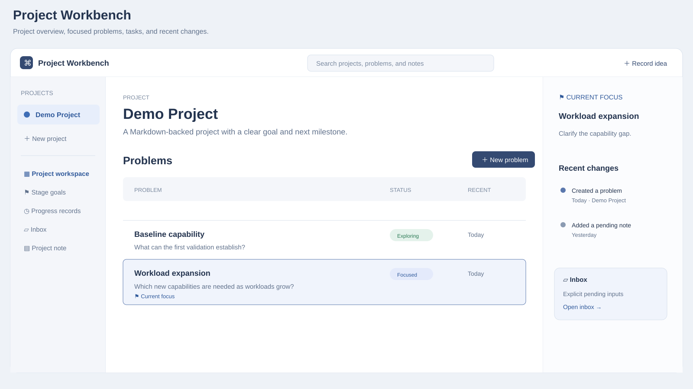

# Obsidian Project Workbench

Project Workbench is a mobile-compatible Obsidian plugin for project planning, research tracking, and progress review. It keeps Markdown as the source of truth and provides a visual workbench for projects, problems, tasks, notes, and explicitly pending inputs.

## Preview



The preview shows the intended three-column workbench: project navigation on the left, the active project and problem list in the center, and focus/timeline/inbox context on the right.

The workbench uses a research-editorial layout:

- left project and navigation sidebar;
- center project summary and problem table;
- right focus panel, timeline, related tasks, and pending inbox;
- responsive stacked layout for narrow screens;
- search, full-text opt-in, multi-select filters, and archived-item toggle;
- create, edit, associate, focus, archive, and open actions;
- conflict-aware Markdown frontmatter writes.

## Data model

Project Workbench reads existing Markdown files. It does not create a database or a second project-state store.

- Projects: `type: project`, `status`, `problems`, `focus_problems`, `current_gate`, `next_milestone`.
- Problems: `type: problem`, `status`, `stage`, `research_role`, `up`, and the `## Next Step` section.
- Tasks: TaskNotes-compatible `status`, `priority`, `due`, `projects`, and `tags` fields.
- Pending inputs: `pending: true` and `processing_status` (`pending`, `linked`, `deferred`, or `reference`).

Existing values are preserved when read. The plugin does not batch-migrate or rename existing notes.

## Install from GitHub Release

普通用户不需要安装 Node.js、npm 或任何开发依赖。直接从 [Project Workbench 0.1.0 Release](https://github.com/PHLens/obsidian-project-workbench/releases/tag/0.1.0) 下载以下三个文件：

```text
main.js
manifest.json
styles.css
```

在目标 Vault 中创建插件目录：

```text
.obsidian/plugins/research-workbench/
```

将三个文件放进去，然后在 Obsidian 的 **设置 → 社区插件 → 已安装插件** 中启用 **Project Workbench**。

桌面端和手机端都使用同一套文件。手机端同样不需要 npm；如果使用 Nutstore 同步 `.obsidian-mobile` 配置，也可以让插件目录和启用状态随 Vault 同步。首次安装后，在手机端重新加载 Obsidian 并启用插件即可。

插件内部 ID 保持为 `research-workbench`，因此目录名和已有配置使用这个 ID；显示名称是 **Project Workbench**。

安装后，从命令面板运行 **Open project workbench**。

## Developer setup and test Vault

All development is performed in the repository's `test-vault/`. The fixture is intentionally generic and contains a Demo Project; it is safe to reset or delete.

开发者如果要修改源码或重新构建，才需要 npm：

```bash
npm install
npm test
npm run typecheck
npm run build
node scripts/check-device-configs.mjs --vault test-vault
```

The test fixture contains separate `.obsidian-desktop` and `.obsidian-mobile` configurations. Both configurations must contain the same plugin bundle and manifest. The checker compares their bundle hashes.

To try the plugin in Obsidian:

1. Open `test-vault` as a Vault.
2. Install or copy the same `main.js`, `manifest.json`, and `styles.css` into the plugin directory for the active device configuration.
3. Enable **Project Workbench** in Community Plugins.
4. Run **Open project workbench** from the command palette.
5. Select a project, create or edit a problem, open the filter panel, and try the focus/association/archive actions.

## Build output

开发者运行 `npm run build` 会产生：

- `dist/main.js` — the Obsidian plugin bundle;
- `dist/context/export-context.js` — the Node CLI context exporter.

Only the plugin entry bundle is intended for mobile Obsidian. The plugin bundle contains no Node.js or Electron imports.

## License

MIT License. See [LICENSE](LICENSE).
